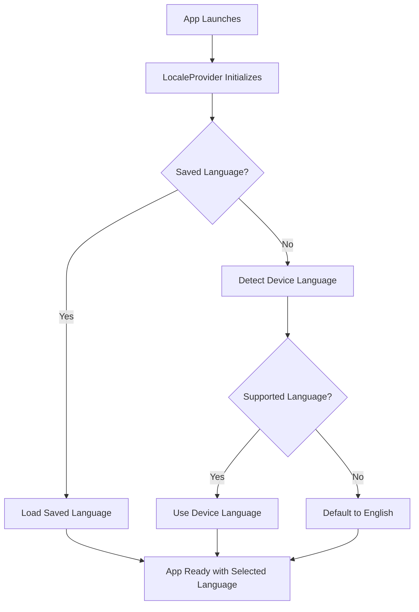
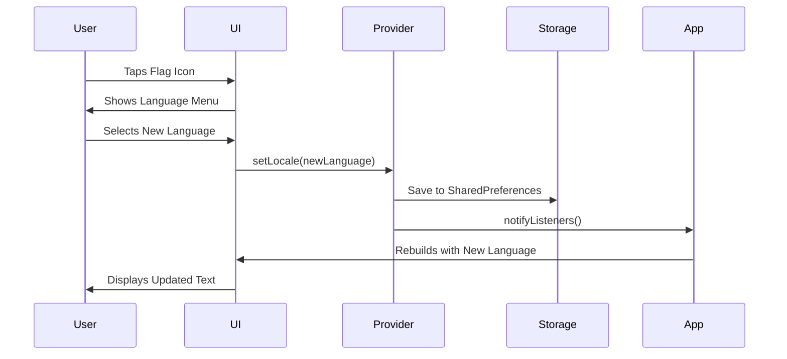

# Multi-Language System Implementation Guide

## 🌍 Overview

This wedding invitation app supports 5 languages with automatic device language detection and persistent language selection. Users can switch languages instantly using country flag icons.

## 📋 Table of Contents

1. [Supported Languages](#supported-languages)
2. [Architecture Overview](#architecture-overview)
3. [How It Works](#how-it-works)
4. [Implementation Details](#implementation-details)
5. [File Structure](#file-structure)
6. [User Experience](#user-experience)
7. [Technical Features](#technical-features)
8. [Adding New Languages](#adding-new-languages)

## 🌐 Supported Languages

| Language | Code | Flag | Display Name | Status |
|----------|------|------|--------------|--------|
| English | `en` | 🇬🇧 | English | ✅ Complete |
| Korean | `ko` | 🇰🇷 | 한국어 | ✅ Complete |
| Chinese | `zh` | 🇨🇳 | 中文 | ✅ Complete |
| Japanese | `ja` | 🇯🇵 | 日本語 | ✅ Complete |
| Malay | `ms` | 🇲🇾 | Bahasa Melayu | ✅ Complete |

## 🏗️ Architecture Overview

```
┌─────────────────────────────────────────┐
│                Main App                 │
├─────────────────────────────────────────┤
│           LocaleProvider                │
│    ┌─────────────────────────────────┐  │
│    │  - Auto-detect device locale   │  │
│    │  - Manage language switching   │  │
│    │  - Save preferences           │  │
│    │  - Provide flag/name mapping  │  │
│    └─────────────────────────────────┘  │
├─────────────────────────────────────────┤
│        Flutter Localizations           │
│    ┌─────────────────────────────────┐  │
│    │  - Load ARB files              │  │
│    │  - Generate AppLocalizations   │  │
│    │  - Handle plural forms         │  │
│    │  - Manage locale delegates     │  │
│    └─────────────────────────────────┘  │
├─────────────────────────────────────────┤
│           UI Components                 │
│    ┌─────────────────────────────────┐  │
│    │  - Language Selector Widget    │  │
│    │  - Localized Text Widgets      │  │
│    │  - Country Flag Display        │  │
│    └─────────────────────────────────┘  │
└─────────────────────────────────────────┘
```

## 🔧 How It Works

### 1. **App Startup Process**



### 2. **Language Detection Logic**

```dart
// 1. Check for saved preference
final savedLocale = prefs.getString('selected_locale');

if (savedLocale != null) {
    // Use saved language
    _locale = Locale(savedLocale);
} else {
    // Auto-detect from system
    final systemLocale = WidgetsBinding.instance.platformDispatcher.locale;
    final supportedCodes = ['en', 'ko', 'zh', 'ja', 'ms'];
    
    if (supportedCodes.contains(systemLocale.languageCode)) {
        _locale = Locale(systemLocale.languageCode);
    } else {
        _locale = const Locale('en'); // Default fallback
    }
}
```

### 3. **Language Switching Flow**



## 🛠️ Implementation Details

### Core Files

#### 1. **LocaleProvider** (`lib/providers/locale_provider.dart`)
```dart
class LocaleProvider extends ChangeNotifier {
  Locale _locale = const Locale('en');
  
  // Supported languages
  static const List<Locale> supportedLocales = [
    Locale('en'), Locale('ko'), Locale('zh'), 
    Locale('ja'), Locale('ms'),
  ];
  
  // Auto-detection and persistence
  Future<void> _loadLocale() async { /* ... */ }
  Future<void> setLocale(Locale locale) async { /* ... */ }
}
```

#### 2. **Main App Configuration** (`lib/main.dart`)
```dart
MaterialApp.router(
  locale: localeProvider.locale,
  supportedLocales: LocaleProvider.supportedLocales,
  localizationsDelegates: const [
    AppLocalizations.delegate,
    GlobalMaterialLocalizations.delegate,
    GlobalWidgetsLocalizations.delegate,
    GlobalCupertinoLocalizations.delegate,
  ],
  // ...
)
```

#### 3. **Language Selector UI** (`lib/widgets/language_selector.dart`)
```dart
// Compact version for app bar
class CompactLanguageSelector extends StatelessWidget {
  @override
  Widget build(BuildContext context) {
    return InkWell(
      onTap: () => _showLanguageDialog(context),
      child: Row(
        children: [
          Text(localeProvider.getFlag(locale)), // 🇬🇧
          Text(locale.languageCode.toUpperCase()), // EN
        ],
      ),
    );
  }
}
```

### Translation Files Structure

```
lib/l10n/
├── app_en.arb    # English translations
├── app_ko.arb    # Korean translations  
├── app_zh.arb    # Chinese translations
├── app_ja.arb    # Japanese translations
└── app_ms.arb    # Malay translations
```

#### Sample ARB File (`app_en.arb`):
```json
{
  "@@locale": "en",
  "appTitle": "Wedding Invitation",
  "weddingInvitation": "WEDDING INVITATION",
  "ourStory": "After meeting during an Indonesia trip...",
  "directionsToVenue": "Directions to {venue}",
  "@directionsToVenue": {
    "placeholders": {
      "venue": {"type": "String"}
    }
  }
}
```

## 📁 File Structure

```
wedding_invitation/
├── l10n.yaml                           # Localization config
├── lib/
│   ├── main.dart                       # App entry with locale setup
│   ├── providers/
│   │   └── locale_provider.dart        # Language state management
│   ├── widgets/
│   │   └── language_selector.dart      # UI for language selection
│   ├── l10n/                          # Translation files
│   │   ├── app_en.arb
│   │   ├── app_ko.arb
│   │   ├── app_zh.arb
│   │   ├── app_ja.arb
│   │   └── app_ms.arb
│   └── presentation/screens/
│       └── home/
│           └── home_screen.dart        # Uses AppLocalizations.of(context)
└── .dart_tool/flutter_gen/gen_l10n/   # Generated localization classes
    └── app_localizations.dart
```

## 👤 User Experience

### 1. **First Launch**
- App detects device language automatically
- If device language is Korean → App starts in Korean
- If device language is unsupported → Defaults to English
- User sees appropriate flag icon in top-right corner

### 2. **Language Switching**
- User taps flag icon (🇰🇷 KO) in top-right corner
- Popup menu shows all available languages with flags:
  ```
  🇬🇧 English           ✓
  🇰🇷 한국어
  🇨🇳 中文
  🇯🇵 日本語
  🇲🇾 Bahasa Melayu
  ```
- User selects desired language
- **Entire app updates instantly** - no restart needed
- Selection is saved automatically

### 3. **Persistent Selection**
- Language choice remembered between app launches
- SharedPreferences stores selected language code
- Next launch uses saved preference instead of device detection

## 🚀 Technical Features

### 1. **Smart Auto-Detection**
```dart
// Priority order:
1. Saved user preference (highest)
2. Device system language (if supported)
3. English fallback (guaranteed)
```

### 2. **Instant Language Switching**
- Uses Flutter's `ChangeNotifier` pattern
- No app restart required
- All text updates simultaneously via `Consumer<LocaleProvider>`

### 3. **Robust Error Handling**
```dart
// Fallback chain:
if (userPreference != null) use userPreference;
else if (systemLanguageSupported) use systemLanguage;
else use defaultEnglish;
```

### 4. **Memory Efficient**
- Only loads current language translations
- ARB files compiled to efficient Dart classes
- Flag emojis stored as constants (no image assets)

### 5. **Parameterized Translations**
```dart
// ARB file:
"directionsToVenue": "Directions to {venue}"

// Usage:
Text(l10n.directionsToVenue('Arbora'))
// Output: "Directions to Arbora"
```

## ➕ Adding New Languages

### Step 1: Add Language Support
```dart
// lib/providers/locale_provider.dart
static const List<Locale> supportedLocales = [
  Locale('en'), Locale('ko'), Locale('zh'), 
  Locale('ja'), Locale('ms'),
  Locale('fr'), // Add French
];

static const Map<String, String> countryFlags = {
  // ... existing flags
  'fr': '🇫🇷', // Add French flag
};

static const Map<String, String> languageNames = {
  // ... existing names  
  'fr': 'Français', // Add French name
};
```

### Step 2: Create Translation File
```bash
touch lib/l10n/app_fr.arb
```

### Step 3: Add Translations
```json
{
  "@@locale": "fr",
  "appTitle": "Invitation de Mariage",
  "weddingInvitation": "INVITATION DE MARIAGE",
  "ourStory": "Après s'être rencontrés lors d'un voyage en Indonésie...",
  // ... all other translations
}
```

### Step 4: Regenerate Localization Files
```bash
flutter gen-l10n
```

### Step 5: Test New Language
- Change device language to French
- Launch app → Should auto-detect French
- Or manually select from language picker

## 🔍 Debugging & Testing

### Common Commands
```bash
# Regenerate localization files
flutter gen-l10n

# Clean and rebuild
flutter clean && flutter pub get

# Test specific locale
flutter run --dart-define=LOCALE=ko
```

### Testing Checklist
- [ ] Auto-detection works for each supported language
- [ ] Manual selection updates entire app instantly  
- [ ] Language preference persists after app restart
- [ ] Unsupported device languages default to English
- [ ] All text elements use localized strings
- [ ] Parameterized strings work correctly
- [ ] Flag emojis display properly on all devices

## 🎯 Performance Considerations

### Optimization Features
1. **Lazy Loading** - Only current language loaded in memory
2. **Efficient Storage** - Uses SharedPreferences (native storage)
3. **No Network Calls** - All translations bundled in app
4. **Minimal UI Updates** - Only rebuilds necessary widgets
5. **Compiled Translations** - ARB files compiled to optimized Dart code

### Memory Usage
- **Per Language**: ~5-10KB of translation data
- **Total Overhead**: ~25-50KB for all 5 languages
- **Runtime**: Only 1 language active in memory

---

## 🎉 Summary

The multi-language system provides:
- **🔄 Automatic language detection** based on device settings
- **🌍 5 language support** with easy expansion capability  
- **⚡ Instant switching** without app restart
- **💾 Persistent preferences** that remember user choice
- **🎨 Beautiful UI** with country flag icons
- **🛡️ Robust fallbacks** ensuring app always works

This implementation follows Flutter best practices and provides a professional, user-friendly internationalization experience for your wedding invitation app.